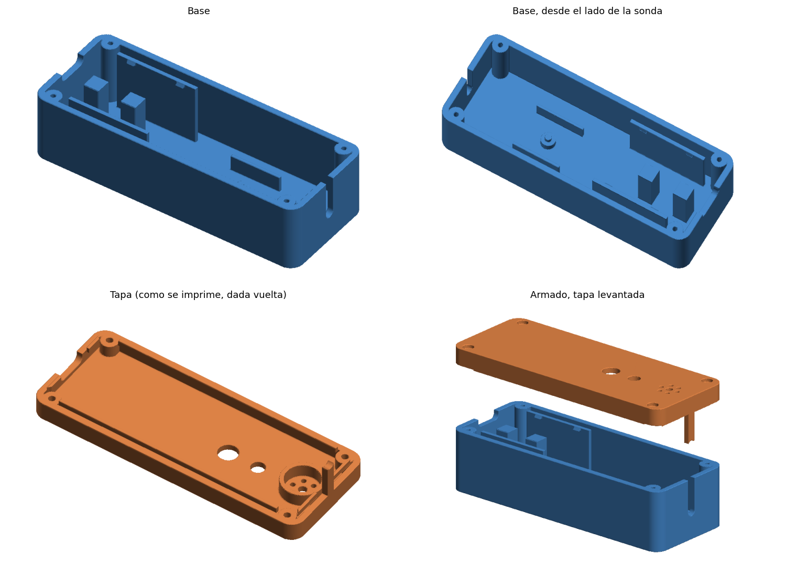

# TermaLab - carcasa v0.4

Carcasa para el módulo central de TermaLab Cocina: ESP32 de 38 pines con
USB-C, lector MAX6675 y termocupla tipo K con terminales de horquilla.



## Estado

STL listos para la primera impresión en la Creality K1C (pico 0,4 mm).
Las medidas de la ESP32 y del MAX6675 se tomaron con calibre el 01/10/2026.
Antes de imprimir todo, imprimir la pieza de prueba del USB (ver abajo).

## Medidas usadas

| Componente | Medida |
|---|---|
| ESP32 (PCB) | 48,2 x 25,8 x 1,6 mm |
| ESP32, pines por debajo | 10 mm + cables Dupont (se dejan 20 mm libres) |
| ESP32, componentes arriba | 3,5 mm |
| MAX6675 (HW-550) | 32,25 x 15,88 mm, 13,57 mm de alto con bornera |
| Carcasa armada | 106,8 x 40,8 x 32,8 mm |
| Paredes, piso y techo | 2,4 mm |

## Qué tiene

**Base**
- Escalón abierto para el USB-C: la ESP32 baja derecho, sin inclinarla.
- Dos columnas centrales bajo la ESP32, entre las filas de pines, y 20 mm
  libres abajo para los Dupont.
- Dos guías laterales con trabas en cuña: la placa entra a presión.
- Soporte del MAX6675: columna con espiga que entra en el agujero del módulo
  y dos guías laterales. Los Dupont del MAX6675 pasan por debajo de la ESP32.
- Ranura de 4 mm para el cable de la sonda en la pared opuesta al USB-C. El
  cable se apoya con las horquillas ya puestas, sin pasarlas por un agujero.
- Cuatro postes con agujero guía para tornillos M2.

**Tapa**
- Lengüeta que baja y cierra la ranura de la sonda, sujetando el cable.
- Agujero de 7,2 mm para un pulsador de panel de 7 mm.
- Agujero de 5,1 mm para un LED de 5 mm.
- Aro de 12,4 mm para un buzzer de 12 mm, con agujeros para el sonido.
- Agujeros avellanados para los tornillos.

## Archivos

- `termalab-carcasa-v0.4-base.stl`: base, orientada para imprimir.
- `termalab-carcasa-v0.4-tapa.stl`: tapa dada vuelta, orientada sin soportes.
- `termalab-carcasa-v0.4-prueba-usb.stl`: los primeros 28 mm de la base, para
  probar el encastre de la ESP32 y el USB-C gastando poco filamento.
- `termalab_carcasa_v04.py` + `decimate.py`: fuente paramétrica (solo numpy).
- `termalab-carcasa-v0.4-stats.json`: parámetros y control de las mallas.

Para regenerar después de cambiar medidas en `P` dentro del `.py`:

```bash
python3 termalab_carcasa_v04.py --h 0.3
```

## Impresión en Creality Print (K1C, pico 0,4)

- Material: PETG recomendado, porque va a estar en la cocina. PLA sirve para
  la prueba.
- Altura de capa 0,20 mm, 3 paredes, 4 o 5 capas arriba y abajo.
- Relleno 15 % giroidal.
- Soportes: no hacen falta.
- Base y tapa tal cual vienen en el STL (la tapa ya está dada vuelta).

## Armado

1. Atornillar las horquillas de la termocupla en la bornera del MAX6675
   (rojo y azul: respetar + y - del módulo; si la temperatura baja al
   calentar, están invertidos).
2. Conectar los 5 Dupont al MAX6675 y apoyarlo en su espiga.
3. Apoyar el cable de la sonda en la ranura.
4. Conectar los Dupont a la ESP32 y bajarla derecho: el USB-C entra en el
   escalón y las trabas la sujetan.
5. Montar pulsador, LED y buzzer en la tapa.
6. Cerrar con 4 tornillos M2 x 16 autorroscantes desde la tapa.

## Pendiente de confirmar

Estas medidas no se tomaron todavía. Se usaron valores típicos y se pueden
cambiar en `P`:

- Diámetro del cable de la sonda (`probeCableD`, hoy 4,0 mm).
- Pulsador (`buttonD`, hoy 7,2 mm para uno de panel de 7 mm).
- LED (`ledD`, hoy 5,1 mm).
- Buzzer (`buzzerD`, hoy 12,4 mm).
