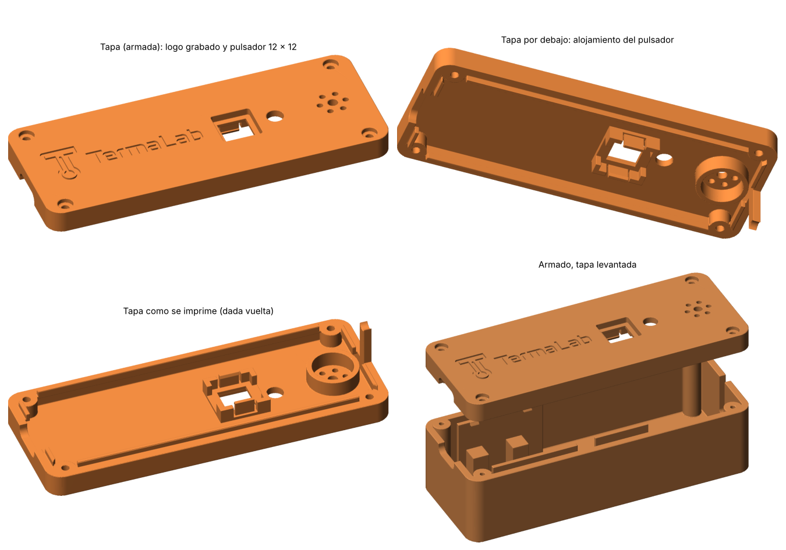

# TermaLab - carcasa v0.5

Carcasa para el módulo central de TermaLab Cocina: ESP32 de 38 pines con
USB-C, lector MAX6675 y termocupla tipo K con terminales de horquilla.



## Qué cambia respecto de la v0.4

Solo cambia la tapa. La base es la misma que en la v0.4.

- **Pulsador:** se reemplaza el pulsador de panel de 7 mm por un pulsador
  táctil de 12 x 12 mm con 4 patas y capuchón cuadrado, que es el que tenemos.
  - Agujero cuadrado de 12,1 mm en el techo para el capuchón.
  - Por debajo del techo hay un alojamiento con un tope arriba, cuatro
    esquineros que centran el cuerpo y dos trabas con diente. El pulsador entra
    a presión desde adentro. Cuando se aprieta, los dientes lo sostienen.
  - El capuchón sobresale 1,2 mm de la tapa.
- **Logo:** el logo de TermaLab (isotipo + "TermaLab") va grabado 0,6 mm en la
  cara de arriba, del lado del USB-C. Mide 48 x 14,5 mm.

## Medidas usadas

| Componente | Medida |
|---|---|
| ESP32 (PCB) | 48,2 x 25,8 x 1,6 mm |
| ESP32, pines por debajo | 10 mm + cables Dupont (se dejan 20 mm libres) |
| ESP32, componentes arriba | 3,5 mm |
| MAX6675 (HW-550) | 32,25 x 15,88 mm, 13,57 mm de alto con bornera |
| Pulsador táctil | cuerpo 12 x 12 x 3,6 mm, capuchón 11,5 mm, alto total 8,3 mm (a confirmar) |
| Carcasa armada | 106,8 x 40,8 x 32,8 mm |
| Paredes, piso y techo | 2,4 mm |

## Archivos

- `termalab-carcasa-v0.5-base.stl`: base, orientada para imprimir (igual a la v0.4).
- `termalab-carcasa-v0.5-tapa.stl`: tapa dada vuelta, sin soportes, con el logo.
- `termalab-carcasa-v0.5-prueba-pulsador.stl`: el trozo de tapa con el
  pulsador (20 mm de largo), para probar el encastre antes de imprimir todo.
- `termalab-carcasa-v0.5-prueba-usb.stl`: los primeros 28 mm de la base.
- `termalab_carcasa_v05.py` + `decimate.py`: fuente paramétrica (solo numpy).
- `logo-tapa.npz`: el logo ya triangulado. Lo genera `logo_tapa.py` a partir
  de `assets/images/branding/logo.png`; solo hay que regenerarlo si cambia el
  logo (necesita Pillow, scipy y scikit-image).
- `termalab-carcasa-v0.5-stats.json`: parámetros y control de las mallas.

Para regenerar después de cambiar medidas en `P` dentro del `.py`:

```bash
python3 termalab_carcasa_v05.py              # todo
python3 termalab_carcasa_v05.py --solo tapa prueba-pulsador
```

La tapa se arma con dos cuerpos que se superponen 0,2 mm: la tapa con un hueco
poco profundo y una "piel" de 1,3 mm con el logo grabado. El slicer los une al
laminar, y por eso el control dice "piezas_sueltas": 2. Se hace así porque
grabar el logo directamente con el campo de distancia pedía una malla de casi
10 millones de triángulos.

## Impresión en Creality Print (K1C, pico 0,4)

- Material: PETG recomendado, porque va a estar en la cocina. PLA sirve para
  las pruebas.
- Altura de capa 0,20 mm, 3 paredes, 4 o 5 capas arriba y abajo.
- Relleno 15 % giroidal.
- Soportes: no hacen falta.
- **Logo a dos colores (opcional):** la tapa se imprime con la cara de arriba
  sobre la cama, así que el logo queda en las 3 primeras capas (0,6 mm). Agregar
  un cambio de filamento al empezar la capa 4 (Z = 0,6 mm). La cara de la tapa
  sale del primer color y el fondo del logo del segundo. Por ejemplo, gris o
  blanco primero y azul oscuro después.
- Si las letras salen cerradas, activar la compensación de pata de elefante
  (0,1 a 0,15 mm) en la primera capa.

## Armado

1. Atornillar las horquillas de la termocupla en la bornera del MAX6675
   (rojo y azul: respetar + y - del módulo; si la temperatura baja al
   calentar, están invertidos).
2. Conectar los 5 Dupont al MAX6675 y apoyarlo en su espiga.
3. Apoyar el cable de la sonda en la ranura.
4. Conectar los Dupont a la ESP32 y bajarla derecho: el USB-C entra en el
   escalón y las trabas la sujetan.
5. Pulsador:
   - Soldar dos cables a dos patas en diagonal (GPIO27 y GND). Las patas
     vienen unidas de a pares por dentro y en diagonal siempre quedan a través
     del contacto.
   - Sacarle el capuchón y meter el cuerpo en el alojamiento desde adentro de
     la tapa, con las patas hacia las caras sin trabas, hasta que hagan clic los
     dientes.
   - Poner el capuchón desde afuera, por el agujero cuadrado.
6. Montar LED y buzzer en la tapa.
7. Cerrar con 4 tornillos M2 x 16 autorroscantes desde la tapa.

## Pendiente de confirmar

Estas medidas no se tomaron todavía. Se usaron valores típicos y se pueden
cambiar en `P`:

- Pulsador: lado del capuchón (`capW`), alto total con capuchón (`swTotalH`),
  alto del cuerpo (`swBodyH`) y alto del capuchón (`capH`).
- Diámetro del cable de la sonda (`probeCableD`, hoy 4,0 mm).
- LED (`ledD`, hoy 5,1 mm).
- Buzzer (`buzzerD`, hoy 12,4 mm).
